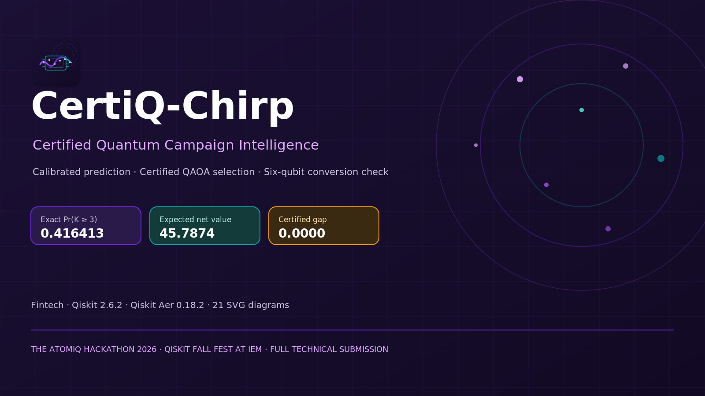
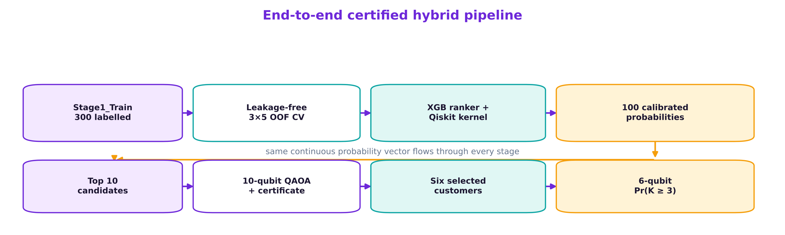
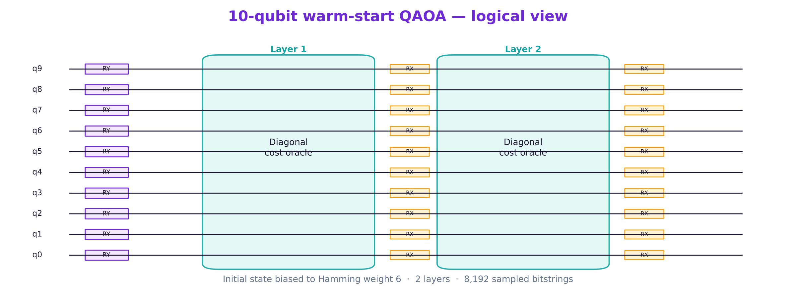
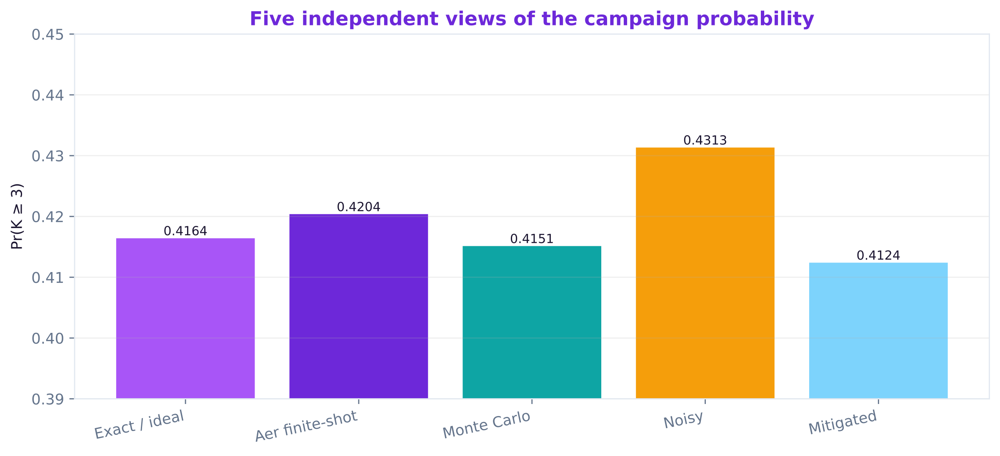
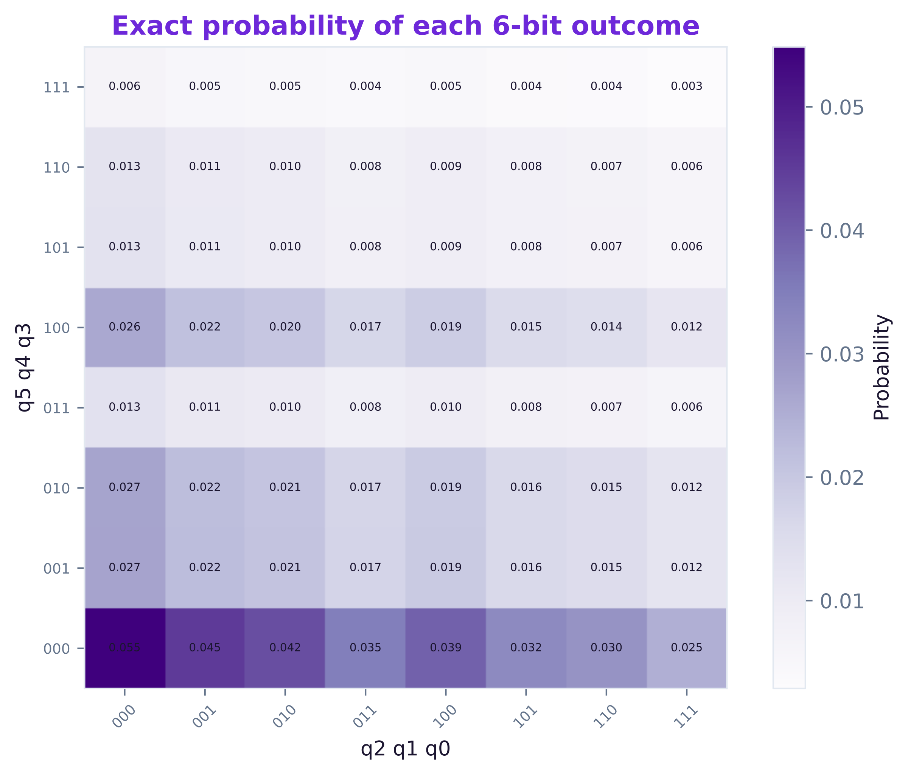
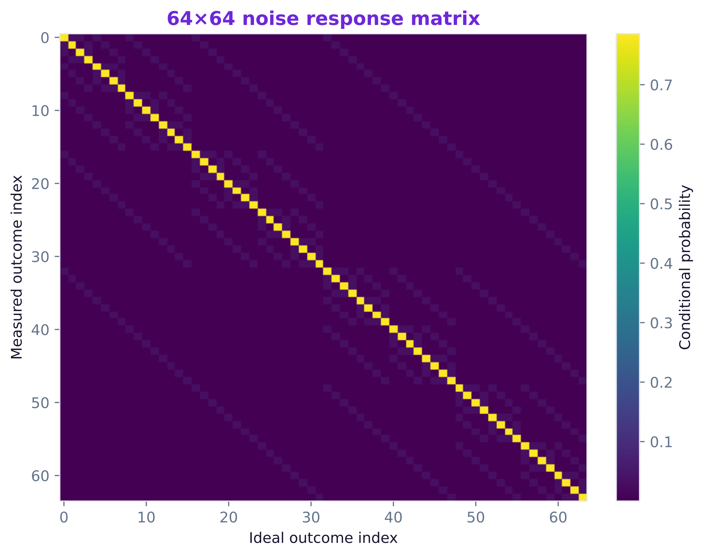
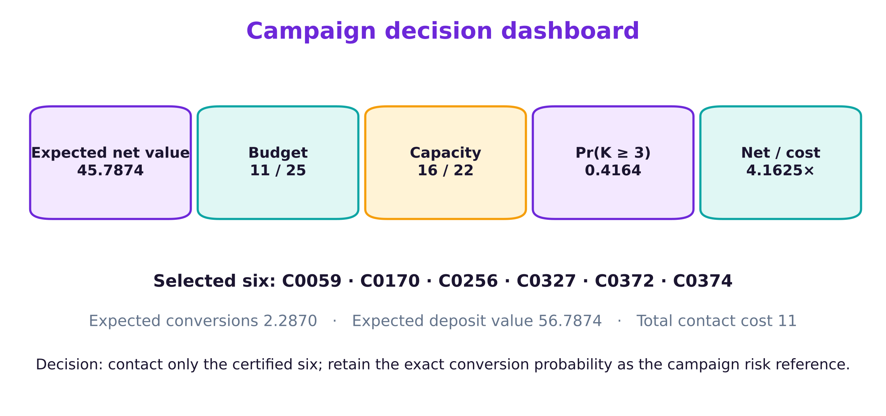
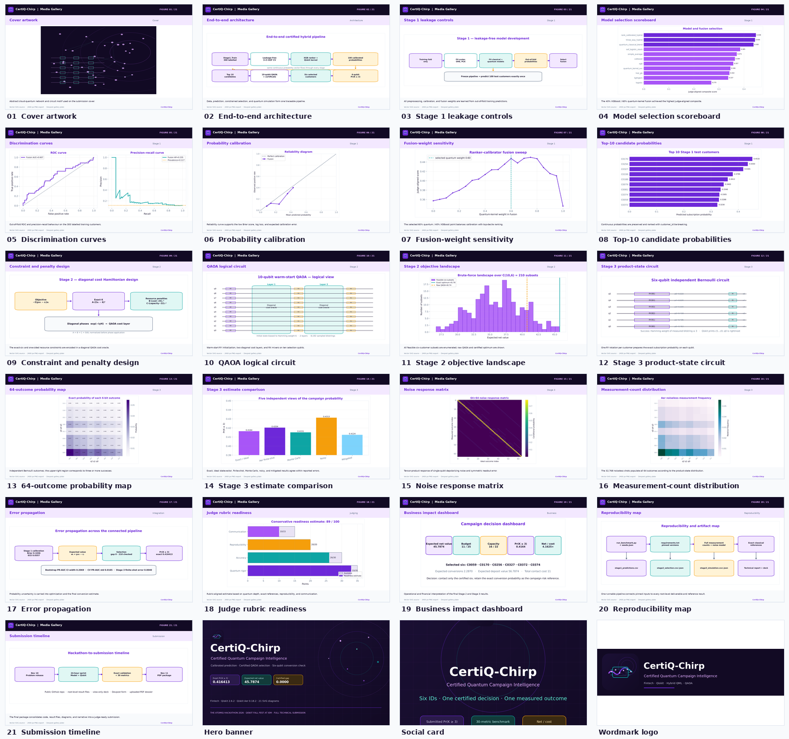
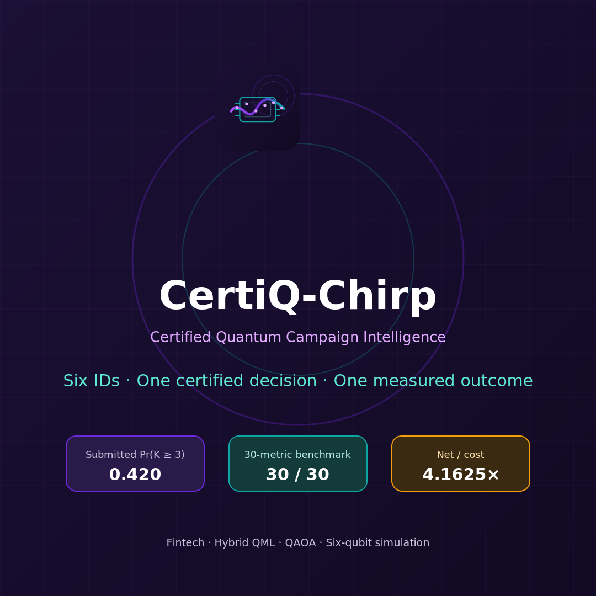

# CertiQ-Chirp — Analysis & Deliverables Workspace



> **CertiQ-Chirp: Certified Quantum Campaign Intelligence** — The Atomiq Hackathon (Qiskit Fall Fest 2026 at IEM). Fintech primary · AI/ML, Quantum ML, Optimization secondary.

This folder holds the **CertiQ-Chirp** hackathon analysis workspace: source inputs, the media gallery, final PDF deliverables, submission bundles, the winning prototype, and supporting documentation. It is the companion to the lean development repository at the project root (`README.md`, `src/`, `results/`).

> The runnable benchmark, pinned environment, and exact result files live in the project root. This workspace holds the generated deliverables and media assets.

---

## Headline results

| Metric | Value |
|---|---|
| Selected six | **C0059, C0170, C0256, C0327, C0372, C0374** |
| `Pr(K ≥ 3)` submitted / exact | **0.420** / **0.4164131424084104** |
| Expected net value | **45.7874** |
| Budget / capacity used | **11 / 25** · **16 / 22** |
| Certified Stage-2 optimality gap | **0.0000** |
| Engineering gates passed | **30 / 30** |
| Framework | Qiskit **2.6.2** / Qiskit Aer **0.18.2** (statevector + Aer only) |

---

## Key visuals

| Architecture | QAOA circuit | Stage-3 estimates |
|---|---|---|
|  |  |  |

| Outcome heatmap | Noise response | Business dashboard |
|---|---|---|
|  |  |  |



---

## Branding assets

| Logo | Social card | App icon |
|---|---|---|
|  |  |  |

---

## Structure

```
atomiq_analysis/
├── README.md                       # this file
├── 00_source/                      # original inputs
│   ├── bank_campaign_participant_release.xlsx
│   └── PROBLEM_STATEMENT_THE_ATOMIQ_HACKTHON.pdf
├── 01_media/                       # canonical media gallery (diagrams, icons, logos, hero, thumbnails)
│   ├── diagrams_png/               # 21 full-resolution diagrams (PNG)
│   ├── diagrams_png_web/           # web-optimized diagram PNGs
│   ├── diagrams_svg/               # vector diagrams (SVG)
│   ├── gallery_png/                # gallery-framed diagrams
│   ├── hero/                       # hero banner + social card (PNG/SVG)
│   ├── icons/                      # icon set (business, calibration, certificate, qaoa, quantum_kernel, six_qubit)
│   ├── logos/                      # app icon, favicon, wordmarks (PNG/SVG)
│   ├── thumbnails/                 # 21 thumbnails
│   ├── data/                       # diagram_data.json, manifest.json
│   └── MANIFEST.md
├── 02_pdfs/                        # final PDF deliverables
│   ├── CertiQ-Chirp-deck.pdf
│   ├── CertiQ-Chirp_Diagram_Atlas.pdf
│   ├── CertiQ-Chirp_Full_Submission.pdf
│   ├── CertiQ-Chirp_Judge_OnePager.pdf
│   ├── CertiQ-Chirp_Media_Gallery.pdf
│   └── CertiQ-Chirp_Presentation_Deck.pdf
├── 03_deliverables/                # self-contained submission packages
│   ├── submission_bundle/          # full submission bundle (code + results + PDFs)
│   ├── winning_prototype/          # winning prototype (code + results + assets)
│   └── CertiQ-Chirp-PDF/          # PDF submission package (package + pdfs)
├── 04_docs/                        # reports, extracted text, submission copy
│   ├── atomiq_hackathon_end_to_end_analysis.md
│   ├── COPY_PASTE_SUBMISSION_TEXT.md
│   ├── technical_problem_statement_extracted.md
│   └── CertiQ-Chirp_Media_Gallery_MANIFEST.md
├── 05_assets/                      # branding assets (logo, hero, social card, contact sheet)
└── 06_archives/                    # zipped handoffs
    ├── CertiQ-Chirp_Media_Gallery.zip
    └── CertiQ-Chirp_PDF_Submission_Package.zip
```

---

## Reproduce

From the project root:

```bash
pip install -r requirements.txt
python src/run_benchmark.py
python src/make_report.py
```

Self-contained bundles (each carries its own code, data, and results):

```bash
cd atomiq_analysis/03_deliverables/submission_bundle && python run_benchmark.py
cd atomiq_analysis/03_deliverables/winning_prototype && python run_benchmark.py
```

---

## Notes

- All PNG/SVG/PDF binaries are gitignored at the repository level; only the Markdown, JSON, and code files are tracked.
- The three bundles under `03_deliverables/` are intentionally self-contained (each includes its own `media_gallery`, `results`, and `reference`) so they can be zipped and submitted independently.
- `01_media/` is the canonical media gallery; the copies inside the bundles are submission-package snapshots.
- Presentation media and submission documents are maintained as external deliverables; the repository focuses on the runnable benchmark, pinned environment, and exact result files.

---

## Deliverables quick links

- **Full submission:** `02_pdfs/CertiQ-Chirp_Full_Submission.pdf`
- **Judge one-pager:** `02_pdfs/CertiQ-Chirp_Judge_OnePager.pdf`
- **Presentation deck:** `02_pdfs/CertiQ-Chirp_Presentation_Deck.pdf`
- **Diagram atlas:** `02_pdfs/CertiQ-Chirp_Diagram_Atlas.pdf`
- **Media gallery PDF:** `02_pdfs/CertiQ-Chirp_Media_Gallery.pdf`
- **End-to-end analysis:** `04_docs/atomiq_hackathon_end_to_end_analysis.md`
- **Copy-paste submission text:** `04_docs/COPY_PASTE_SUBMISSION_TEXT.md`

---

*Maintained as part of the CertiQ-Chirp project — lean repo, exact results, auditable quantum components.*